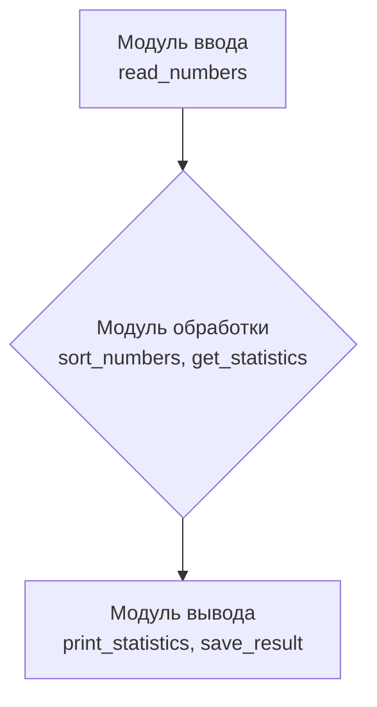

# Разработка и интеграция программных модулей

**МДК 02.02 · группа 3424А**

## 1. Цель работы

Изучить современные принципы и методы разработки программных приложений и освоить подходы к интеграции программных модулей: разработать модули ввода, обработки и вывода данных, интегрировать их в единое приложение и протестировать.

## 2. Использованные принципы и методы разработки

- **Модульность** — приложение разбито на три модуля с чёткими границами: ввод, обработка, вывод.
- **Единственная ответственность (SRP)** — каждый модуль решает одну задачу: модуль ввода только читает файл, модуль обработки только считает, модуль вывода только печатает и сохраняет.
- **Слабое связывание** — модули не знают друг о друге и обмениваются только простыми данными (список чисел, словарь статистики); связует их только основной файл.
- **Стандарты кодирования** — код оформлен по PEP 8, каждая функция снабжена docstring (проверено pycodestyle и Pylint).

## 3. Подход к интеграции

Выбрана **последовательная композиция модулей** через импорт: основной файл `task1555_main.py` импортирует три модуля и связывает их в конвейер «ввод → обработка → вывод», где выход одного модуля является входом следующего. Ошибки (файл не найден, нечисловые данные, пустой список) передаются между модулями исключениями и обрабатываются на границе приложения — в `main()`.



## 4. Разработанные модули

| Файл | Функции | Назначение |
|---|---|---|
| [task1555_input_module.py](task1555_input_module.py) | `read_numbers` | Чтение чисел из текстового файла |
| [task1555_processing_module.py](task1555_processing_module.py) | `sort_numbers`, `get_statistics` | Сортировка списка и расчёт статистики (сумма, среднее, минимум, максимум) |
| [task1555_output_module.py](task1555_output_module.py) | `print_statistics`, `save_result` | Печать статистики и сохранение результата в файл |
| [task1555_main.py](task1555_main.py) | `main` | Интеграция модулей в приложение, обработка ошибок |

## 5. Результаты тестирования

**Модульные тесты** (каждый модуль проверен отдельно):

```text
ввод: [9.0, 3.5, 17.0, 42.0, 1.0, 25.8, 6.0]
сортировка по убыванию: [3, 2, 1]
статистика [10, 20, 30]: {'count': 3, 'total': 60, 'average': 20.0, 'minimum': 10, 'maximum': 30}
пустой список -> ValueError: список чисел пуст
```

**Интеграционный тест** (приложение целиком, файл [task1555-data.txt](task1555-data.txt)):

```text
Прочитано чисел: 7
Отсортированные данные: [1.0, 3.5, 6.0, 9.0, 17.0, 25.8, 42.0]
Количество чисел: 7
Сумма: 104.3
Среднее: 14.9
Минимум: 1.0
Максимум: 42.0
Результат сохранён в файл: task1555-result.txt
```

**Тест обработки ошибок:** при отсутствии файла приложение выводит «Ошибка: файл 'task1555-data.txt' не найден» и завершается без аварийного падения.

**Проверка стандартов:** `pycodestyle` — нарушений нет.

## 6. Вывод

Разработаны и интегрированы три программных модуля (ввод, обработка, вывод) по принципам модульности, единственной ответственности и слабого связывания. Интеграция выполнена последовательной композицией через импорт в основном файле. Тестирование показало корректную работу каждого модуля по отдельности и приложения в целом, включая обработку ошибочных ситуаций. Такая архитектура упрощает сопровождение: замена источника данных (например, с файла на базу данных) потребует переписывания только модуля ввода, не затрагивая остальные.
