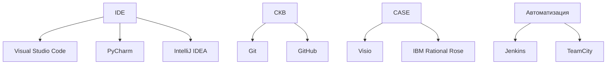

# Анализ и классификация инструментальных средств разработки ПО

**МДК 02.02 · группа 3424А**
**Презентация:** [1601-instrumenty-prezentaciya.pptx](1601-instrumenty-prezentaciya.pptx)

## 1. Цель работы

Изучить и классифицировать основные инструментальные средства разработки ПО: интегрированные среды разработки (IDE), системы контроля версий (СКВ), CASE-средства и инструменты автоматизации сборки.

## 2. Сводная таблица

| Инструмент | Тип | Функции | Примеры использования | Преимущества | Недостатки |
|---|---|---|---|---|---|
| Visual Studio Code | IDE | Редактирование кода, отладка, подсветка синтаксиса, расширения | Разработка веб- и Python-приложений | Бесплатный, кроссплатформенный, огромный каталог расширений | Слабее полноценных IDE для больших проектов, нужна ручная настройка |
| PyCharm | IDE | Редактирование, отладка, рефакторинг, поддержка Django/Flask, работа с БД | Профессиональная разработка на Python | Глубокий анализ кода, всё из коробки | Платная Pro-версия, требователен к ресурсам |
| IntelliJ IDEA | IDE | Редактирование, отладка, рефакторинг, поддержка JVM-стека | Разработка на Java/Kotlin | Мощный рефакторинг, умные подсказки | Платная Ultimate-версия, тяжёлая |
| Git | СКВ | Локальный контроль версий, ветки, слияния, история изменений | Версионирование кода в любом проекте | Быстрый, распределённый, стандарт отрасли | Порог входа: консоль, концепции индекса и ветвления |
| GitHub | СКВ (хостинг) | Хостинг репозиториев Git, pull request, код-ревью, Issues, Actions | Совместная разработка, CI/CD | Популярность, бесплатные публичные репозитории, экосистема | Зависимость от внешнего сервиса, ограничения бесплатного тарифа |
| Visio | CASE-средство | Построение диаграмм: блок-схемы, UML, ER, сетевые схемы | Проектирование БД и бизнес-процессов | Простой интерфейс, интеграция с MS Office | Платный, только Windows, нет генерации кода |
| IBM Rational Rose | CASE-средство | UML-моделирование, генерация кода по моделям | Проектирование архитектуры ПО по UML | Полная поддержка UML, прямое/обратное проектирование | Устаревший интерфейс, сложность, дорогой |
| Jenkins | Инструмент автоматизации сборки | CI/CD-конвейеры, автоматические сборки и тесты по расписанию/событию | Автосборка и тестирование при каждом коммите | Бесплатный, сотни плагинов, гибкость | Требует отдельного сервера и настройки, устаревший UI |
| TeamCity | Инструмент автоматизации сборки | CI/CD-конвейеры, управление агентами сборки, отчёты о тестах | Сборка проектов в корпоративной среде | Удобный интерфейс, поддержка из коробки | Платный при масштабировании, меньше плагинов, чем у Jenkins |

## 3. Краткие описания инструментов

**Visual Studio Code** — лёгкий бесплатный редактор кода от Microsoft с отладчиком, Git-интеграцией и тысячами расширений. Подходит для большинства языков. Популярен в веб-разработке и учебных проектах.

**PyCharm** — специализированная IDE от JetBrains для Python. Из коробки: умное автодополнение, рефакторинг, отладчик, поддержка фреймворков и баз данных. Есть бесплатная Community-версия.

**IntelliJ IDEA** — флагманская IDE для Java и Kotlin от JetBrains. Известна мощным анализом кода и рефакторингом. Стандарт в корпоративной Java-разработке; Ultimate-версия платная.

**Git** — распределённая система контроля версий: хранит историю изменений кода, позволяет вести параллельную работу в ветках и сливать их. Работает локально, не требует сервера. Де-факто стандарт отрасли.

**GitHub** — облачный хостинг Git-репозиториев с социальными функциями: pull request, код-ревью, задачи (Issues), CI/CD (Actions). Центр совместной разработки и open-source.

**Visio** — средство визуального моделирования от Microsoft: блок-схемы, ER- и UML-диаграммы. Простое освоение, интеграция с Office. Генерацию кода не выполняет, подходит для документирования.

**IBM Rational Rose** — классическое CASE-средство для UML-проектирования: диаграммы классов, вариантов использования, последовательностей, с генерацией кода по моделям. Мощное, но устаревшее и сложное в освоении.

**Jenkins** — открытый сервер автоматизации: собирает проект, запускает тесты и развёртывание при каждом изменении кода. Настраивается конвейерами (pipeline), расширяется плагинами. Требует своего сервера.

**TeamCity** — CI/CD-сервер от JetBrains: сборки, тесты, отчёты, управление агентами. Отличается удобным интерфейсом и быстрой настройкой по сравнению с Jenkins, но платный при росте числа конфигураций.

## 4. Классификация (схема)

## 5. Вывод

Проанализировано и классифицировано девять инструментальных средств по четырём категориям: IDE (VS Code, PyCharm, IntelliJ IDEA) служат для написания и отладки кода; СКВ (Git, GitHub) — для контроля версий и совместной работы; CASE-средства (Visio, Rational Rose) — для моделирования и проектирования; инструменты автоматизации сборки (Jenkins, TeamCity) — для непрерывной интеграции. Для каждого инструмента указаны тип, функции, примеры использования, преимущества и недостатки. Видно, что инструменты не конкурируют, а дополняют друг друга: типовая цепочка разработки строится как «IDE → Git/GitHub → Jenkins/TeamCity», а CASE-средства обслуживают этап проектирования до начала кодирования.
