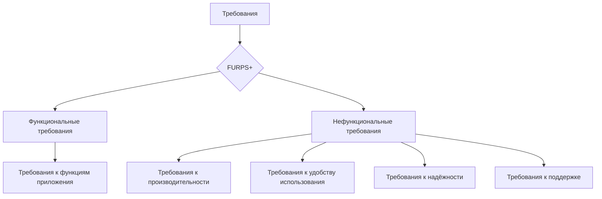

# Анализ требований к мобильному приложению для заказа такси с использованием модели FURPS+

**МДК 02.02 «Жизненный цикл программного обеспечения» · группа 3424А**

## 1. Цель и объект анализа

**Цель работы** — изучить модель FURPS+ и применить её для анализа требований к программному обеспечению.

**Объект анализа** — мобильное приложение для заказа такси: клиентское приложение пассажира (Android/iOS), приложение водителя и серверная часть (диспетчеризация заказов, платежи, уведомления).

## 2. Краткое описание компонентов модели FURPS+

- **F — Functionality (функциональность).** Что система должна делать: функции, возможности, бизнес-правила.
- **U — Usability (удобство использования).** Интерфейс, эстетика, обучаемость, документация для пользователя.
- **R — Reliability (надёжность).** Работа без отказов, целостность данных, восстанавливаемость после сбоев.
- **P — Performance (производительность).** Время отклика, пропускная способность, потребление ресурсов, нагрузка.
- **S — Supportability (сопровождаемость).** Тестируемость, расширяемость, конфигурируемость, переносимость, установка.
- **«+» — ограничения.** Законодательные, аппаратные и интерфейсные требования, ограничения реализации.

## 3. Схема связи требований с моделью



## 4. Требования к приложению по компонентам FURPS+

### F — Functionality (функциональность)

- **F1.** Регистрация и авторизация пассажира по номеру телефона (SMS-код).
- **F2.** Заказ такси: указание точек подачи и назначения на карте или адресом, выбор тарифа («эконом», «комфорт», «бизнес»).
- **F3.** Автоматический расчёт предварительной стоимости и времени подачи до подтверждения заказа.
- **F4.** Подбор водителя и отображение его положения на карте в реальном времени.
- **F5.** Оплата поездки банковской картой в приложении или наличными.
- **F6.** Push-уведомления о смене статуса заказа (принят, машина подана, поездка завершена).
- **F7.** Связь пассажира с водителем (чат или звонок через приложение без раскрытия личных номеров).
- **F8.** История поездок и выставление оценки водителю после завершения заказа.
- **F9.** Отмена заказа с указанием причины.

### U — Usability (удобство использования)

- **U1.** Интерфейс полностью на русском языке.
- **U2.** Оформление заказа — не более чем в 3 касания из главного экрана (адрес подачи подставляется по геопозиции).
- **U3.** Освоение приложения новым пользователем без инструкции — не более 5 минут.
- **U4.** Крупные интерактивные элементы (не менее 48×48 dp) — управление одной рукой «на ходу».
- **U5.** Поддержка тёмной темы оформления.

### R — Reliability (надёжность)

- **R1.** Доступность серверной части — не менее 99,9 % времени в месяц (не более ~44 минут простоя).
- **R2.** Списание оплаты за поездку выполняется ровно один раз; при сбое платёжного шлюза заказ не теряется, оплата повторяется после восстановления связи.
- **R3.** При обрыве сети на стороне пассажира активный заказ сохраняется; после переподключения приложение восстанавливает актуальное состояние поездки.
- **R4.** Точность определения геопозиции — не хуже 20 метров в городской застройке.
- **R5.** Ежедневное резервное копирование данных заказов и пользователей.

### P — Performance (производительность)

- **P1.** Холодный запуск приложения — не более 2 секунд на устройстве среднего класса.
- **P2.** Обновление положения машины на карте — каждые 5 секунд.
- **P3.** Отклик интерфейса на действия пользователя — не более 0,5 секунды.
- **P4.** Сервер обрабатывает до 10 000 одновременных активных заказов без деградации времени отклика.

### S — Supportability (сопровождаемость)

- **S1.** Кроссплатформенная разработка: Android и iOS из общей кодовой базы.
- **S2.** Изменение тарифов и коэффициентов ценообразования — на стороне сервера, без выпуска новой версии приложения.
- **S3.** Модульная архитектура: карты, платежи и уведомления — заменяемые модули.
- **S4.** Централизованное логирование событий заказа и сбор отчётов об ошибках (crash-аналитика).
- **S5.** Тестируемость: покрытие бизнес-логики модульными тестами не менее 70 %.

### «+» — ограничения

- **+1.** Обработка персональных данных (ФИО, телефон, геолокация) — в соответствии с ФЗ-152 «О персональных данных»; хранение данных граждан РФ — на серверах в РФ.
- **+2.** Платёжный модуль — по стандарту PCI DSS, без хранения данных банковских карт в приложении.
- **+3.** Соответствие правилам магазинов приложений Google Play и App Store (модерация, политика конфиденциальности).
- **+4.** Интеграция с картографическим сервисом по его публичному API (лицензионное ограничение).
- **+5.** Соблюдение законодательства о перевозках пассажиров легковым такси (передача данных о заказах в реестр).

## 5. Сводная таблица соответствия требований компонентам FURPS+

| № | Требование | Компонент FURPS+ |
|---|---|---|
| F1 | Регистрация по номеру телефона (SMS-код) | Functionality |
| F2 | Заказ такси: точки на карте, выбор тарифа | Functionality |
| F3 | Предварительный расчёт стоимости и времени подачи | Functionality |
| F4 | Подбор водителя, его положение на карте в реальном времени | Functionality |
| F5 | Оплата картой в приложении или наличными | Functionality |
| F6 | Push-уведомления о статусе заказа | Functionality |
| F7 | Связь с водителем без раскрытия личных номеров | Functionality |
| F8 | История поездок, оценка водителя | Functionality |
| F9 | Отмена заказа с указанием причины | Functionality |
| U1 | Интерфейс на русском языке | Usability |
| U2 | Заказ не более чем в 3 касания | Usability |
| U3 | Освоение без инструкции ≤ 5 минут | Usability |
| U4 | Элементы управления ≥ 48×48 dp | Usability |
| U5 | Тёмная тема оформления | Usability |
| R1 | Доступность сервиса ≥ 99,9 % | Reliability |
| R2 | Списание оплаты ровно один раз, заказ не теряется при сбое | Reliability |
| R3 | Восстановление состояния поездки после обрыва сети | Reliability |
| R4 | Точность геопозиции ≤ 20 м | Reliability |
| R5 | Ежедневное резервное копирование | Reliability |
| P1 | Холодный запуск приложения ≤ 2 с | Performance |
| P2 | Обновление позиции машины каждые 5 с | Performance |
| P3 | Отклик интерфейса ≤ 0,5 с | Performance |
| P4 | До 10 000 одновременных заказов на сервере | Performance |
| S1 | Общая кодовая база Android/iOS | Supportability |
| S2 | Тарифы меняются на сервере без обновления приложения | Supportability |
| S3 | Заменяемые модули: карты, платежи, уведомления | Supportability |
| S4 | Логирование заказов, crash-аналитика | Supportability |
| S5 | Покрытие логики тестами ≥ 70 % | Supportability |
| +1 | Персональные данные по ФЗ-152, серверы в РФ | + (ограничения) |
| +2 | Платежи по стандарту PCI DSS | + (ограничения) |
| +3 | Правила Google Play и App Store | + (ограничения) |
| +4 | Картографический API по лицензии | + (ограничения) |
| +5 | Законодательство о таксомоторных перевозках | + (ограничения) |

## 6. Влияние компонентов FURPS+ на разработку и тестирование

- **F** задаёт объём функциональных тестов: каждый пользовательский сценарий (заказ, оплата, отмена) превращается в набор модульных и интеграционных тестов.
- **U** проверяется не автотестами, а UX-исследованиями: коридорные тесты, фокус-группы, метрика «касаний до заказа».
- **R** требует тестирования отказоустойчивости: искусственные обрывы сети, недоступность платёжного шлюза, перезапуск сервисов.
- **P** превращается в нагрузочное тестирование: эмуляция пиковой нагрузки (час пик, непогода) и замер времени отклика.
- **S** обеспечивается код-ревью, статическим анализом и CI: требование «тарифы без обновления приложения» напрямую влияет на архитектуру (конфигурация выносится на сервер).
- **«+»** порождает юридическую и инфраструктурную проверку: аудит персональных данных, выбор хостинга в РФ, сертификация платёжного контура.

Таким образом, каждая «буква» модели задаёт свой вид тестирования и свою зону ответственности в команде.

## 7. Автоматизация классификации требований (Python)

Файл `furps_analyze.py` в этом же каталоге реализует предложенный в задании подход: разносит требования по компонентам модели по ключевым словам.

```python
KEYWORDS = {
    "Usability (U)":      ["интерфейс", "русском", "обучени", "касани", "тёмн"],
    "Reliability (R)":    ["сбо", "обрыв", "сети", "сохран", "резерв"],
    "Performance (P)":    ["секунд", "одновременн", "нагрузк", "отклик"],
    "Supportability (S)": ["модульн", "тест", "лог", "сервер", "конфигурац"],
    "+ (ограничения)":    ["152-фз", "закон", "pci", "лицензи", "стандарт"],
    "Functionality (F)":  ["заказ", "водител", "оплат", "уведомл", "тариф"],
}

def analyze_requirements(requirements_list):
    """Разносит требования по компонентам модели FURPS+ по ключевым словам."""
    result = {component: [] for component in KEYWORDS}
    result["Не классифицировано"] = []
    for requirement in requirements_list:
        text = requirement.lower()
        for component, words in KEYWORDS.items():
            if any(word in text for word in words):
                result[component].append(requirement)
                break  # требование отнесено к первому подошедшему компоненту
        else:
            result["Не классифицировано"].append(requirement)
    return result
```

**Результат запуска:**

```text
Usability (U):
  - Интерфейс должен быть на русском языке, заказ - не более чем в 3 касания
Reliability (R):
  - При обрыве сети активный заказ должен сохраняться
Performance (P):
  - Обновление позиции машины - каждые 5 секунд
Supportability (S):
  - Тарифы должны меняться на сервере без обновления приложения
+ (ограничения):
  - Обработка персональных данных - в соответствии с 152-ФЗ
Functionality (F):
  - Пассажир должен видеть положение водителя на карте в реальном времени
Не классифицировано:
  - Приложение должно корректно масштабироваться на планшетах
```

Строка «Не классифицировано» показывает ограничение ключевого подхода: формулировку без слов-маркеров словарь распознать не может, и такие требования приходится разносить вручную.

## 8. Вывод

Модель FURPS+ применена к анализу требований мобильного приложения для заказа такси: сформулировано 33 требования, и все они распределились по шести компонентам модели без «бесхозных». Классификация сразу вскрыла специфичные для такси-сервиса риски: геолокация и номера телефонов — это персональные данные со строгими требованиями закона, платежи требуют соответствия PCI DSS, а обрыв сети в поездке — штатная, а не аварийная ситуация, которую нужно проектировать отдельно. FURPS+ доказала свою полезность как «чек-лист полноты»: работа по модели гарантирует, что команда не забудет нефункциональные требования, и напрямую задаёт состав будущего тест-плана. Для полного покрытия характеристик качества модель целесообразно дополнять стандартом ГОСТ Р ИСО/МЭК 25010-2015.

## Источники

- ГОСТ Р ИСО/МЭК 25010-2015 «Системная и программная инженерия. Модели качества систем и программных продуктов».
- ISO/IEC/IEEE 29148 «Systems and software engineering — Requirements engineering».
- Rational Unified Process (RUP): классификация требований FURPS+.
