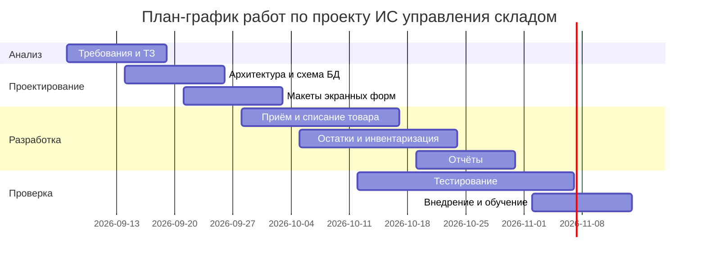
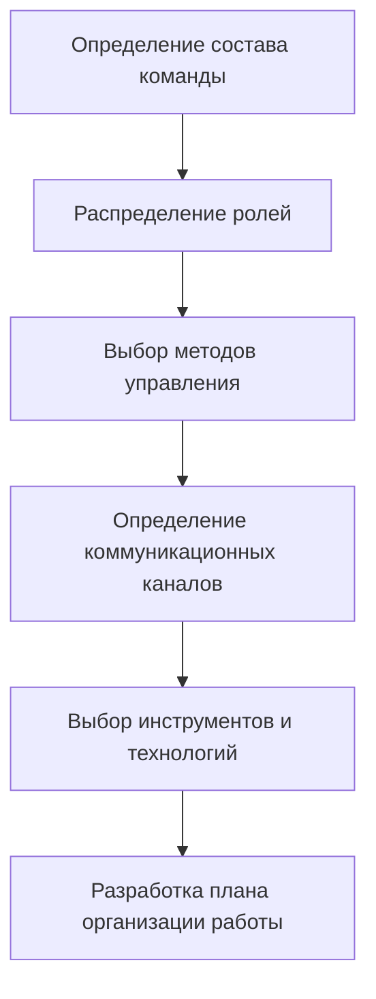

# План организации работы команды разработчиков

**Проект: информационная система для управления складом · МДК 02.02 · группа 3424А**

## 1. Цель работы

Разработать план организации работы команды разработчиков для проекта по созданию информационной системы управления складом: распределить роли, выбрать методы управления проектом, определить коммуникационные каналы, подобрать инструменты и составить график выполнения задач.

## 2. Состав команды и распределение ролей

Команда — 6 человек; совмещение ролей допускается только для смежных областей.

| № | Роль | Назначение |
|---:|---|---|
| 1 | Руководитель проекта | Планирование, контроль сроков, связь с заказчиком |
| 2 | Аналитик | Анализ складских процессов, требования, технические задания |
| 3 | Ведущий разработчик | Архитектура системы, основные функциональные модули, код-ревью |
| 4 | Программист | Разработка модулей учёта товаров и отчётов |
| 5 | Тестировщик | Тестовые сценарии, проверка работоспособности, регистрация ошибок |
| 6 | Дизайнер интерфейсов | Макеты экранных форм, удобство работы кладовщика |

## 3. Метод управления проектом

Выбран **Kanban** с еженедельными планёрками. Обоснование выбора:

- разработка ИС для склада идёт непрерывным потоком задач: требования кладовщиков и учётчиков поступают регулярно, жёсткие спринты Scrum дали бы лишние простои при смене приоритетов;
- доска Kanban делает поток задач видимым всей команде: колонки «Бэклог» → «Анализ» → «Разработка» → «Тестирование» → «Готово»;
- WIP-лимиты (не более 2 задач в «Разработке» на человека, не более 3 задач в «Тестировании») не дают накапливаться незавершённой работе;
- еженедельная планёрка пополняет бэклог и сверяет приоритеты с заказчиком.

Для сравнения: Waterfall отвергнут, так как требования к складскому учёту будут уточняться (сезонные пики, новые категории товаров), а чистый Scrum — из-за неравномерного потока задач.

## 4. Коммуникационные каналы

| Канал | Назначение | Регламент |
|---|---|---|
| Еженедельная планёрка | Пополнение бэклога, приоритеты, итоги недели | Понедельник, 30–40 минут |
| Доска Kanban | Статусы и владельцы всех задач | Обновление каждый день |
| Telegram-чат | Оперативные вопросы | Ответ в течение часа в рабочее время |
| GitHub (pull request) | Код-ревью перед слиянием | Ревью не позднее следующего рабочего дня |
| Wiki | Требования, инструкции, регламенты | Актуализация по мере изменений |

Правило эскалации: проблема, не решённая в чате за день, выносится на планёрку; проблема, блокирующая сроки, — немедленно руководителю проекта.

## 5. Инструменты и технологии

| Категория | Инструмент | Обоснование выбора |
|---|---|---|
| Контроль версий | Git + GitHub | Стандарт отрасли; ветка на задачу, история изменений, код-ревью |
| Управление задачами | GitHub Projects (доска Kanban) | Доска рядом с кодом, не нужен отдельный сервис |
| Язык и бэкенд | Python 3 | Скорость разработки, стандартная библиотека |
| База данных | PostgreSQL | Надёжное хранение складских остатков, транзакции |
| Тестирование | pytest | Модульные тесты бизнес-логики учёта |
| Макеты | Figma | Совместное обсуждение экранных форм с заказчиком |
| Связь | Telegram | Привычен команде, быстрые уведомления |

## 6. План-график выполнения задач

| № | Этап | Срок | Ответственный |
|---:|---|---|---|
| 1 | Анализ складских процессов, требования и ТЗ | 07.09–18.09 | Аналитик |
| 2 | Проектирование архитектуры и схемы БД | 14.09–25.09 | Ведущий разработчик |
| 3 | Макеты экранных форм | 21.09–02.10 | Дизайнер интерфейсов |
| 4 | Модуль приёма и списания товара | 28.09–16.10 | Ведущий разработчик |
| 5 | Модуль остатков и инвентаризации | 05.10–23.10 | Программист |
| 6 | Модуль отчётов | 19.10–30.10 | Программист |
| 7 | Тестирование всех модулей | 12.10–06.11 | Тестировщик |
| 8 | Внедрение и обучение кладовщиков | 02.11–13.11 | Руководитель проекта, аналитик |

## 7. Схема организации работы

## 8. Вывод

Составлен план организации работы команды из шести человек для проекта ИС управления складом. Распределены роли (от аналитика до дизайнера интерфейсов), выбран метод Kanban — он соответствует непрерывному потоку складских задач и делает узкие места видимыми через WIP-лимиты; определены коммуникационные каналы с регламентами и правилом эскалации, подобраны инструменты (Git + GitHub, PostgreSQL, pytest, Figma) с обоснованием каждого выбора. План-график из восьми этапов с ответственными и диаграммой Ганта покрывает путь от анализа требований до внедрения и обучения кладовщиков. План учитывает специфику складского проекта: критичность целостности данных остатков (транзакции PostgreSQL), простоту интерфейса для неквалифицированного персонала и регулярное уточнение требований заказчиком.
