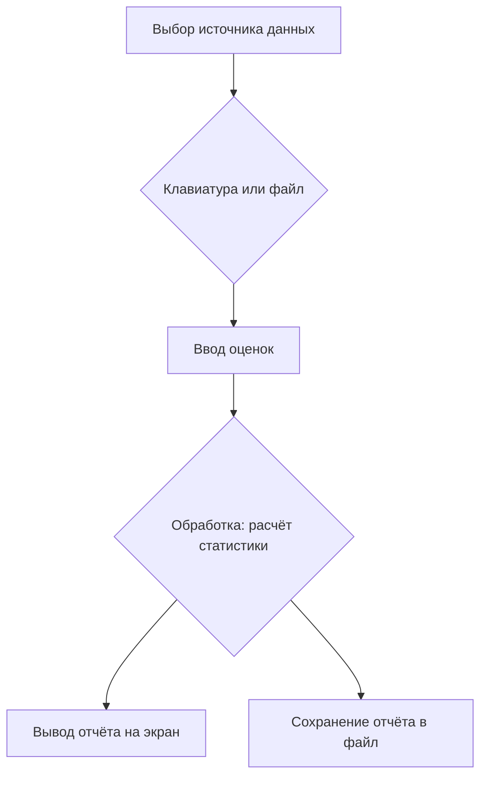

# Разработка программного модуля для курсовой работы

**МДК 02.02 · группа 3424А**

## 1. Постановка задачи

Разработать программный модуль «Анализ результатов учебной сессии»: программа читает оценки студентов (с клавиатуры или из файла), рассчитывает статистику (количество, средний балл, минимум, максимум, сортировка по убыванию) и выводит результаты на экран и в файл отчёта.

## 2. Описание алгоритма



Алгоритм состоит из четырёх шагов:

1. **Ввод.** Пользователь выбирает источник: клавиатура (числа через пробел) или текстовый файл (по числу в строке). Оба варианта возвращают список чисел.
2. **Обработка.** По списку оценок считается статистика: количество, среднее арифметическое, минимум, максимум; список сортируется по убыванию. Пустой список — ошибка.
3. **Формирование отчёта.** Статистика оформляется в текстовый отчёт.
4. **Вывод.** Отчёт печатается на экран и сохраняется в файл `task1690-report.txt`.

Ошибочные ситуации (файл не найден, нечисловые данные, пустой список) перехватываются и выдают понятное сообщение вместо аварийного падения.

## 3. Код программы

Файл [task1690_kursovaya_module.py](task1690_kursovaya_module.py). Программа структурирована на функции с единственной ответственностью, каждая снабжена docstring и комментариями; код соответствует PEP 8 (проверено pycodestyle).

## 4. Результаты работы программы

**Режим ввода из файла** (файл [task1690-grades.txt](task1690-grades.txt), 8 оценок):

```text
Отчёт по результатам сессии
Оценок всего: 8
Средний балл: 4.12
Минимальная оценка: 3.0
Максимальная оценка: 5.0
Оценки по убыванию: [5.0, 5.0, 5.0, 4.0, 4.0, 4.0, 3.0, 3.0]
Отчёт сохранён в файл: task1690-report.txt
```

**Режим ввода с клавиатуры** (введено «5 4 3 5»):

```text
Оценок всего: 4
Средний балл: 4.25
Минимальная оценка: 3.0
Максимальная оценка: 5.0
Оценки по убыванию: [5.0, 5.0, 4.0, 3.0]
```

**Проверка обработки ошибок:** при отсутствии файла выводится «Ошибка: файл 'task1690-grades.txt' не найден»; при нечисловых данных — «Ошибка в данных: ...». Программа не падает ни в одном из сценариев.

## 5. Вывод

Разработан структурированный программный модуль, реализующий полный цикл «ввод → обработка → вывод»: два источника ввода (клавиатура и файл), расчёт статистики по оценкам, вывод результатов на экран и в файл. Программа отлажена, протестирована в обоих режимах ввода и на ошибочных данных, оформлена по PEP 8 с комментариями и docstring. Модульная структура функций позволяет легко заменить источник данных или формат отчёта без переписывания остального кода.
