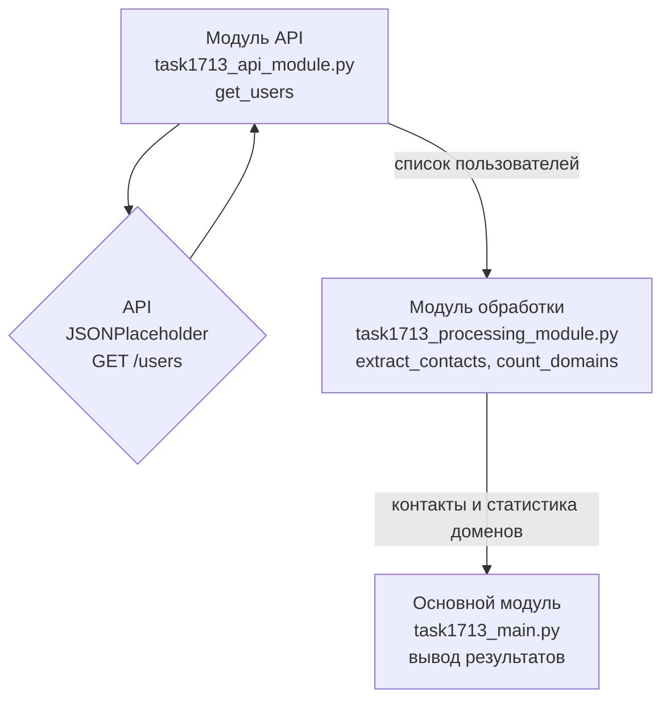

# Работа с API и обмен данными между модулями

**МДК 02.02 · группа 3424А**

## 1. Цель работы

Изучить инструменты для работы с API и обмена данными между модулями и применить их на практике: разработать программу, получающую данные из внешнего API и передающую их между модулями.

**Выбранный API:** JSONPlaceholder (`https://jsonplaceholder.typicode.com`) — открытый тестовый REST API, не требующий авторизации. Используется эндпоинт `GET /users`, возвращающий JSON-список пользователей. Обращение к API выполнено стандартной библиотекой Python (`urllib.request`), без сторонних пакетов.

## 2. Схема взаимодействия модулей



Обмен данными устроен так: модуль API возвращает «сырой» список словарей из JSON; основной модуль передаёт его в функции модуля обработки, которые возвращают простые структуры (список пар, словарь); основной модуль печатает результат. Модули связаны только данными, что соответствует принципу слабого связывания.

## 3. Листинг кода

- [task1713_api_module.py](task1713_api_module.py) — модуль доступа к API (`get_json`, `get_users`);
- [task1713_processing_module.py](task1713_processing_module.py) — обработка данных (`extract_contacts` извлекает контакты, `count_domains` считает статистику доменов e-mail);
- [task1713_main.py](task1713_main.py) — основной модуль: связывает модули и выводит результат, обрабатывает сетевые ошибки (`OSError`).

Код соответствует PEP 8 (проверено pycodestyle), все функции снабжены docstring и комментариями.

## 4. Результаты тестирования

Запрос к API выполнен успешно, получено 10 пользователей; данные обработаны обоими функциями:

```text
Получено пользователей: 10

Контакты:
  Leanne Graham - Sincere@april.biz
  Ervin Howell - Shanna@melissa.tv
  Clementine Bauch - Nathan@yesenia.net
  ...

Домены e-mail:
  april.biz: 1
  melissa.tv: 1
  yesenia.net: 1
  kory.org: 1
  annie.ca: 1
  ...
```

Проверена и обработка ошибки: при недоступности API программа выводит «Ошибка при обращении к API: ...» и завершается корректно.

## 5. Вывод

Разработана программа, взаимодействующая с внешним REST API и обменивающаяся данными между тремя модулями: получение (API-модуль), обработка (извлечение контактов, статистика доменов), вывод (основной модуль). Программа протестирована на реальных запросах к API; ошибки сети обрабатываются. Архитектура со слабым связыванием позволяет заменить API-источник, не трогая логику обработки.
