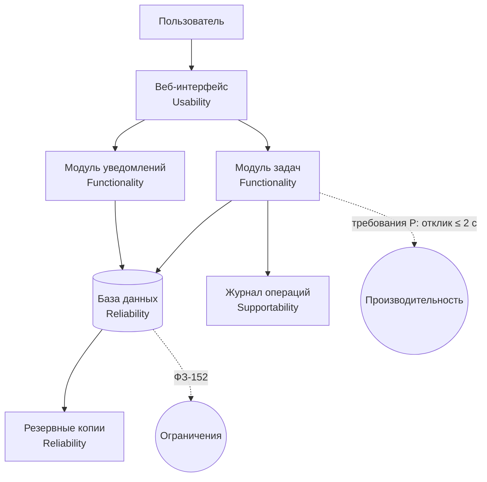

# Анализ требований к системе управления задачами по модели FURPS+

**МДК 02.02 · группа 3424А**

## 1. Цель и шаги работы

Цель — применить модель FURPS+ для определения и структурирования требований к системе управления задачами для IT-компании (создание, редактирование, отслеживание задач).

Шаги работы: изучены компоненты FURPS+; определены функциональные и нефункциональные требования; требования структурированы по компонентам модели в таблице; на основе таблицы построена схема взаимодействия компонентов системы.

## 2. Таблица требований по компонентам FURPS+

| № | Требование | Компонент FURPS+ |
|---:|---|---|
| 1 | Создание задачи: название, описание, исполнитель, срок, приоритет | Functionality |
| 2 | Редактирование задачи и смена статуса («новая» → «в работе» → «завершена») | Functionality |
| 3 | Комментарии и вложения к задачам | Functionality |
| 4 | Доска задач и фильтры по исполнителю, статусу, сроку | Functionality |
| 5 | Уведомления о назначении задачи и приближении срока | Functionality |
| 6 | Освоение системы новым сотрудником без инструкции — до 1 часа | Usability |
| 7 | Интерфейс на русском языке, drag-and-drop карточек на доске | Usability |
| 8 | Автосохранение редактируемой задачи каждые 30 секунд | Reliability |
| 9 | Ежедневное резервное копирование; восстановление ≤ 1 часа | Reliability |
| 10 | Открытие доски с 1000 задач — не более 2 секунд | Performance |
| 11 | До 100 одновременных пользователей без замедления | Performance |
| 12 | Модульная архитектура, покрытие тестами ≥ 70 %, логирование действий | Supportability |
| 13 | Персональные данные сотрудников — по ФЗ-152; пароли в виде хешей | «+» (ограничения) |
| 14 | Реализация: Python + PostgreSQL, развёртывание в контуре компании | «+» (ограничения) |

## 3. Схема взаимодействия компонентов системы

Компоненты FURPS+ отображены на части системы: функциональность — это модули задач и уведомлений; удобство — веб-интерфейс; надёжность — база данных и резервные копии; сопровождаемость — журнал операций; производительность и ограничения — сквозные требования ко всей системе.

## 4. Вывод

Сформулировано 14 требований к системе управления задачами; все они структурированы по шести компонентам FURPS+ без пропусков. Таблица показывает, что функциональный каркас (создание, редактирование, отслеживание задач) дополнен измеримыми нефункциональными требованиями и ограничениями; схема связывает компоненты модели с реальными частями системы. Такая структура требований готова к трассировке: каждое требование можно провести через разработку и тестирование до приёмки.
