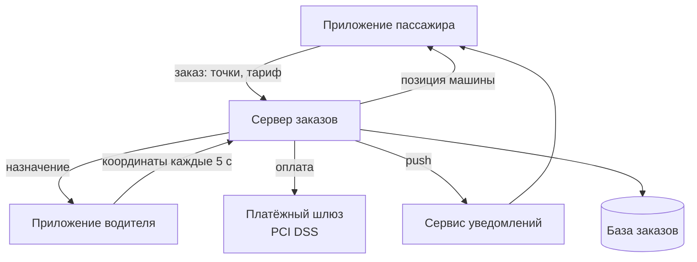

# Анализ требований к мобильному приложению для заказа такси (FURPS+)

**МДК 02.02 · группа 3424А**

## 1. Цель работы

Проанализировать функциональные и нефункциональные требования к мобильному приложению для заказа такси, используя модель FURPS+, сгруппировать их в таблице и построить схему взаимодействия компонентов приложения (поток данных).

## 2. Таблица требований

| № | Требование | Категория | Компонент FURPS+ |
|---:|---|---|---|
| 1 | Заказ такси: точки подачи/назначения, выбор тарифа, предварительная цена | Функциональное | Functionality |
| 2 | Подбор водителя и его положение на карте в реальном времени | Функциональное | Functionality |
| 3 | Оплата картой или наличными; чек на e-mail | Функциональное | Functionality |
| 4 | Push-уведомления о смене статуса заказа | Функциональное | Functionality |
| 5 | Чат/звонок с водителем без раскрытия личных номеров | Функциональное | Functionality |
| 6 | Заказ не более чем в 3 касания, интерфейс на русском | Нефункциональное | Usability |
| 7 | При обрыве сети активный заказ сохраняется и восстанавливается | Нефункциональное | Reliability |
| 8 | Оплата списывается ровно один раз; сбой шлюза не теряет заказ | Нефункциональное | Reliability |
| 9 | Запуск приложения ≤ 2 с; позиция машины обновляется каждые 5 с | Нефункциональное | Performance |
| 10 | Кроссплатформенная разработка Android/iOS из общей кодовой базы | Нефункциональное | Supportability |
| 11 | Тарифы меняются на сервере без обновления приложения | Нефункциональное | Supportability |
| 12 | Геолокация и телефон — по ФЗ-152; платежи — по PCI DSS | Ограничение | «+» |

## 3. Схема взаимодействия компонентов (поток данных)

Поток данных: заказ рождается в приложении пассажира, сервер назначает водителя и становится посредником всех обменов (координаты, статусы, оплата, уведомления), а данные оседают в базе заказов. Нефункциональные требования из таблицы накладываются на эти потоки: R — на связь «пассажир–сервер», P — на обновление координат, «+» — на поток оплаты.

## 4. Вывод

Сформулировано 12 требований к приложению заказа такси: 5 функциональных, 6 нефункциональных (U, R, P, S) и 1 ограничение. Схема потока данных показала, что сервер заказов — центральный узел системы: именно через него проходят требования надёжности (неразрывность заказа) и ограничения (платёжный контур). Группировка по FURPS+ гарантирует полноту: каждая категория качества представлена хотя бы одним проверяемым требованием.
