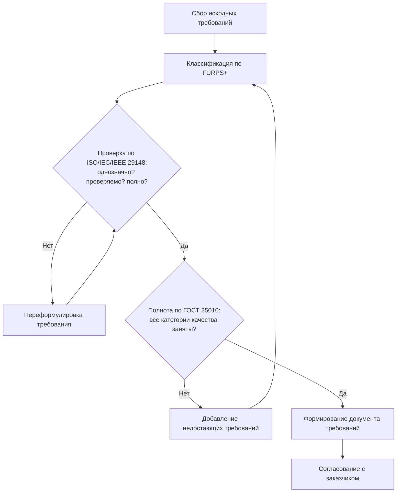

# Анализ и выбор стандартов требований к программному обеспечению

**Проект: система управления требованиями для нового программного продукта · МДК 02.02 · группа 3424А**

## 1. Основные понятия

Требования к ПО делятся на **функциональные** (что система делает) и **нефункциональные** (качества: производительность, надёжность, удобство, сопровождаемость). Модель **FURPS+** — чек-лист полноты: F (функциональность), U (удобство), R (надёжность), P (производительность), S (сопровождаемость), «+» (ограничения). Для нашего проекта наиболее важны компоненты F (ядро продукта — управление требованиями), S (система должна легко расширяться шаблонами) и R (требования — ценные данные, потери недопустимы).

## 2. Анализ стандартов и методологий

| Стандарт | Основные положения | Преимущества | Недостатки | Пример применения |
|---|---|---|---|---|
| ISO/IEC/IEEE 29148 | Процессы инженерии требований, критерии хорошего требования, форматы SRS | Современный международный эталон; объединил IEEE 830 | Требует обучения аналитиков | Спецификации требований в IT-проектах |
| IEEE 830 | Классическая структура спецификации SRS | Простая и понятная структура документа | Устарел (заменён 29148), слабее про нефункциональные | Учебные и небольшие проекты |
| ISO/IEC 12207 | Процессы жизненного цикла ПО целиком | Встраивает требования в общий ЖЦ | Широкий, нужна адаптация под проект | Крупные корпоративные разработки |
| ГОСТ 34.602-2020 | Содержание ТЗ на автоматизированную систему | Обязателен в РФ-госпроектах, чёткие разделы | Тяжеловесен для малых проектов | Госзаказ, автоматизация предприятий |
| ГОСТ Р ИСО/МЭК 25010-2015 | Модель характеристик качества | Конкретные измеримые характеристики | Не про процесс, а про качество | Проверка полноты нефункциональных требований |
| FURPS+ (RUP) | Классификация требований | Быстрый чек-лист полноты | Нет отдельной категории безопасности | Agile-команды, карточки требований |

## 3. Выбор для проекта

Для системы управления требованиями выбрана связка: **ISO/IEC/IEEE 29148** (форма записи требований), **FURPS+** (классификация и контроль полноты), **ГОСТ Р ИСО/МЭК 25010-2015** (шаблон нефункциональных характеристик). ГОСТ 34.602-2020 будет подключён при оформлении итогового ТЗ, если заказчик работает по отечественным нормам. Обоснование: продукт сам про требования — его собственные требования должны быть эталонно оформлены; 29148 даёт критерии качества записи, FURPS+ — полноту покрытия, 25010 — измеримость качеств.

## 4. Блок-схема процесса анализа и стандартизации требований

## 5. Вывод

Проанализированы шесть стандартов и методологий работы с требованиями, для каждого приведены положения, преимущества, недостатки и примеры применения. Для проекта выбрана связка ISO/IEC/IEEE 29148 + FURPS+ + ГОСТ Р ИСО/МЭК 25010-2015; процесс анализа и стандартизации формализован блок-схемой с двумя контрольными циклами (качество записи и полнота покрытия).
