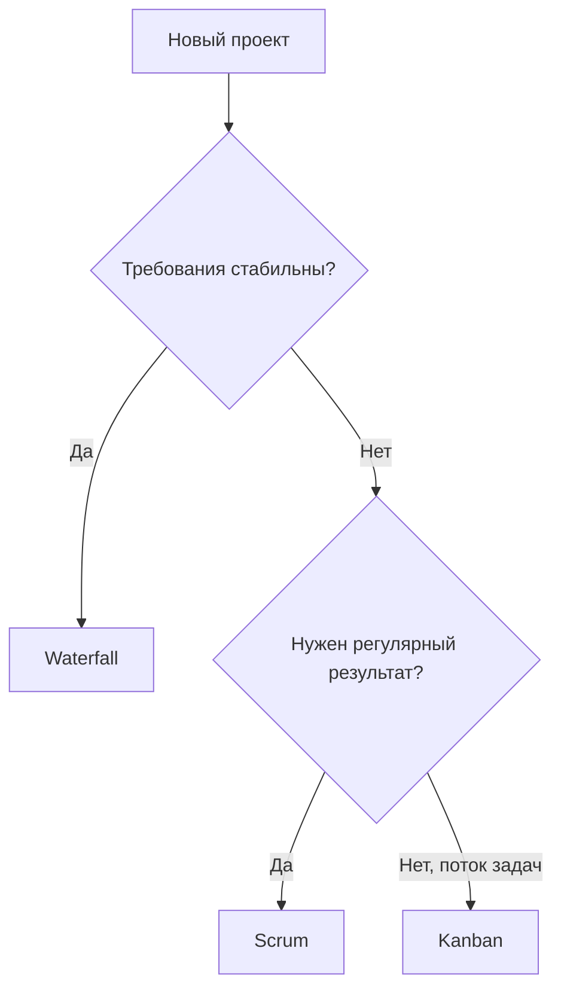

# Анализ методов организации работы в команде разработчиков

**Проект: создание информационной системы · МДК 02.02 · группа 3424А**

## 1. Цель работы

Изучить методы организации работы в команде разработчиков (Waterfall, Agile, Scrum, Kanban), проанализировать их преимущества и недостатки и выбрать наиболее подходящие для проекта.

## 2. Сравнительная таблица методов

| Метод | Суть | Преимущества | Недостатки | Пример из практики |
|---|---|---|---|---|
| Waterfall | Этапы строго последовательно, изменений нет | Предсказуемые сроки и бюджет; сильная документация | Изменение требований ломает план; результат виден в конце | Госпроекты по ГОСТ 34 с фиксированным ТЗ |
| Agile | Итерации, обратная связь важнее плана | Гибкость к изменениям, ранний результат | Требует вовлечённого заказчика; сроки «плавают» | Продуктовые IT-компании |
| Scrum | Спринты 1–4 недели, роли (PO, SM), регулярные встречи | Регулярный инкремент, дисциплина, прозрачность | Не подходит для потока мелких разнородных задач | Разработка новых функций продукта |
| Kanban | Поток задач по доске, WIP-лимиты | Гибкий, видит узкие места, без жёстких итераций | Слабее предсказуемость по срокам | Поддержка и сопровождение систем |

## 3. Применимость методов к этапам разработки

| Этап | Подходящий метод | Почему |
|---|---|---|
| Планирование | Waterfall (рамка) + Agile (бэклог) | Общие вехи фиксируются, детали гибкие |
| Реализация | Scrum | Новая функциональность удобно режется на спринты |
| Тестирование | Kanban | Поток дефектов неравномерен, спринты мешают |
| Внедрение | Waterfall | Переход на продуктив — строго запланированное событие |
| Сопровождение | Kanban | Поток мелких доработок и инцидентов |

## 4. Схема выбора метода

## 5. Выбор для нашего проекта и обоснование

Для проекта создания информационной системы выбран **Scrum на этапе реализации** (требования заказчика уточняются, важны регулярные демо) **с Kanban на этапе сопровождения** (поток ошибок и мелких доработок). Обоснование: чистый Waterfall рискован из-за нестабильных требований; чистый Kanban не даёт ритма поставки; Scrum покрывает главную фазу создания продукта, а Kanban естественно принимает систему после внедрения. Такое сочетание на практике называют Scrumban и применяют команды, у которых фаза активной разработки сменяется фазой поддержки.

## 6. Вывод

Проанализированы четыре метода организации работы: приведены суть, преимущества, недостатки и практические примеры каждого, составлена карта применимости по этапам жизненного цикла. Универсально «лучшего» метода нет: выбор определяется стабильностью требований и характером потока задач. Для нашего проекта обоснованно выбрана комбинация Scrum + Kanban.
